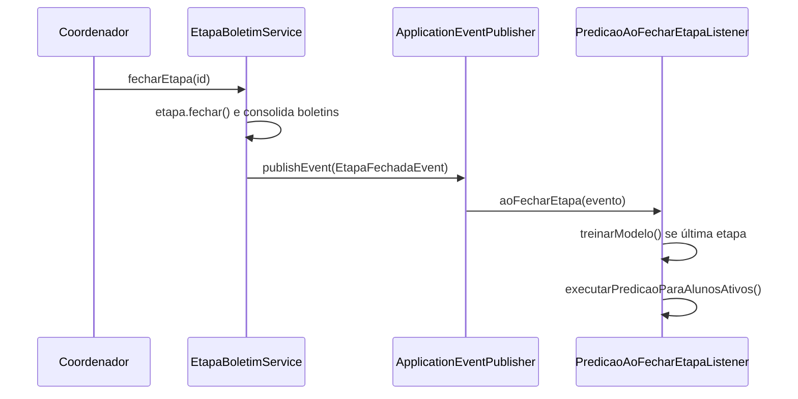

# Padrões de projeto

Este documento lista os padrões de projeto usados no back-end do EduGestão: onde cada um está no código e que problema resolve.

## Padrões GoF

### Strategy: fórmula da média (RN-03)

O regimento da escola define se a média da etapa é ponderada ou aritmética, e essa escolha é configurada por ano letivo (`AnoLetivo.formulaMedia`). Cada fórmula é uma estratégia:

| Papel | Classe |
|---|---|
| Strategy | `avaliacao.media.CalculoMediaStrategy` |
| Estratégias concretas | `MediaPonderadaStrategy`, `MediaAritmeticaStrategy` |
| Seleção | `CalculoMediaStrategy.para(FormulaMedia)` |
| Contexto | `AvaliacaoService.calcularMedia(...)`, usado no boletim (`EtapaBoletimService`) e na IA (`PredicaoRiscoService`) |

Para criar uma nova fórmula (por exemplo, descartar a menor nota), basta escrever outra implementação e registrá-la em `para(...)`. Boletim e IA continuam iguais.

### State: ciclo de vida da etapa

A etapa segue o fluxo `ABERTA → FECHADA → PUBLICADA`. Cada constante de `academico.entity.StatusEtapa` decide quais transições aceita e devolve o próximo estado. Uma transição inválida lança `RegraNegocioException`. A entidade `Etapa` só delega (`status = status.fechar()`).

O estado também responde se aceita lançamento livre de notas e frequência (`permiteLancamentoLivre()`), e essa resposta é usada na regra RN-04 em `AutorizacaoAlteracaoService`.

### Observer: reações ao fechamento e à publicação da etapa

Fechar ou publicar uma etapa dispara ações em outros módulos. Antes, `EtapaBoletimService` chamava a IA e a comunicação diretamente. Agora ele publica eventos pelo `ApplicationEventPublisher` do Spring, e cada módulo reage por conta própria:

| Evento (sujeito) | Observador | Reação |
|---|---|---|
| `academico.evento.EtapaFechadaEvent` | `ia.service.PredicaoAoFecharEtapaListener` | Executa a predição de risco (RF-11) e retreina o modelo ao fim do ano letivo |
| `academico.evento.EtapaPublicadaEvent` | `comunicacao.service.ComunicadoBoletimPublicadoListener` | Publica um comunicado automático para alunos e responsáveis |

Os observadores rodam de forma síncrona, na mesma transação do fechamento. Se a predição falhar, o fechamento é desfeito, como já acontecia antes da refatoração.

### Factory: criação de usuários por perfil

`Usuario` é abstrata e tem uma subclasse por perfil (herança JPA `SINGLE_TABLE`). `usuario.factory.UsuarioFactory.criar(Perfil)` guarda, num `EnumMap`, qual construtor usar para cada perfil, e assim `UsuarioService` não precisa conhecer as subclasses concretas.

## Padrões arquiteturais e de apoio

| Padrão | Onde |
|---|---|
| Arquitetura em camadas (Controller → Service → Repository) | Todos os módulos (`academico`, `avaliacao`, `diario`, `ia` etc.) |
| Repository | Interfaces `*Repository` (Spring Data JPA) |
| DTO | Pacotes `dto`, com `record`s e fábricas estáticas `fromEntity(...)` |
| Injeção de dependência | Injeção por construtor em todos os serviços (Spring) |
| Singleton | Beans do Spring (escopo padrão) e as instâncias únicas das estratégias de média |

## Testes

| Padrão | Classe de teste |
|---|---|
| Strategy | `CalculoMediaStrategyTest`, `AvaliacaoServiceTest` |
| State | `StatusEtapaTest`, `AutorizacaoAlteracaoServiceTest` |
| Observer | `PredicaoAoFecharEtapaListenerTest` |
| Factory | `UsuarioFactoryTest` |
